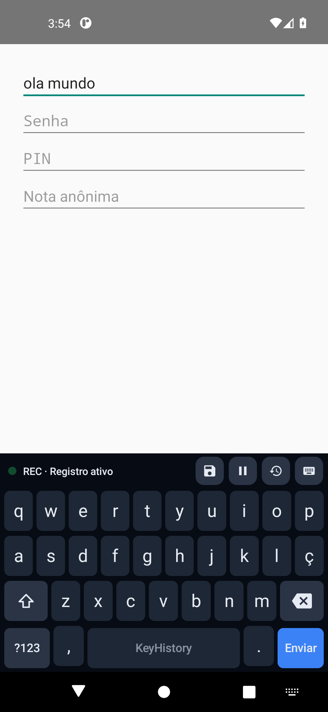
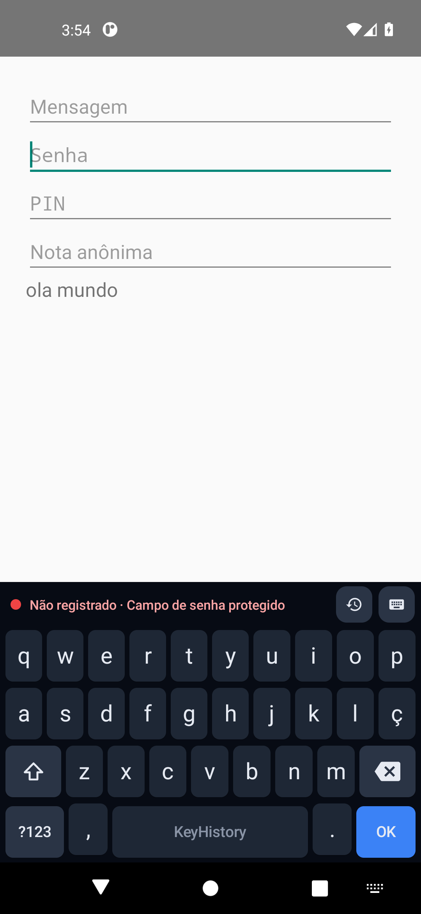
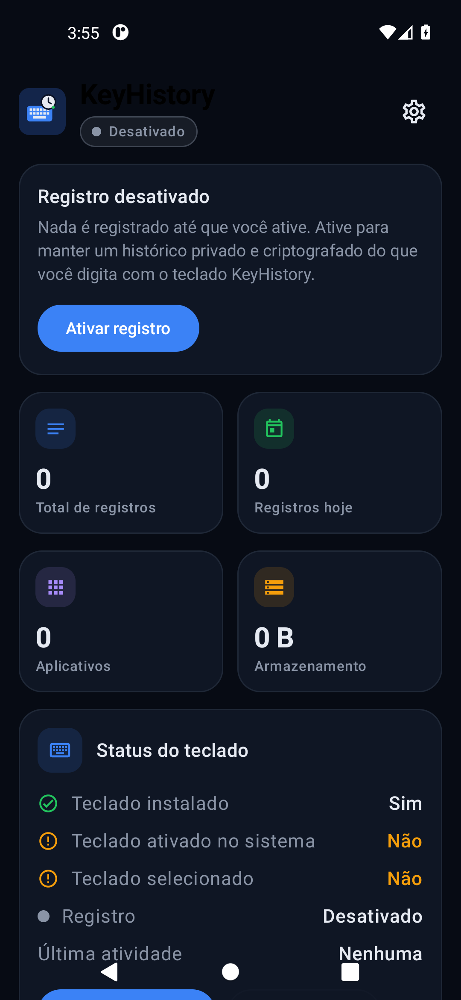

# Relatório de testes — KeyHistory 1.0.0

Os testes são executados automaticamente pelo GitHub Actions (`.github/workflows/android.yml`) a cada envio ao repositório:

1. **Build**: compilação (Kotlin/Compose/KSP-Room), testes unitários JVM, APK debug, APK release (R8 + shrink de recursos), lint.
2. **Emulador**: Android 11 (API 30, x86_64, Google APIs, perfil Pixel 5) com testes instrumentados + verificação do APK de release (`scripts/ci-emulator.sh`).
3. **Publicação**: o APK de release aprovado é gravado em `apk/` e as capturas de tela em `docs/screenshots/`.

O ambiente de desenvolvimento usado não tinha Android SDK nem acesso ao repositório Maven do Google; por isso **toda a compilação e os testes foram executados no GitHub Actions**, e não em um aparelho físico. Os testes em emulador usam o Android real (InputMethodManager, Keystore, Room/SQLite, seletor de teclado), mas recomenda-se ainda um teste manual em aparelho físico (ver item 13).

## Resultado (execução #4 do workflow, commit `ef64fc0`)

| Etapa | Resultado |
|---|---|
| Compilação debug + release (R8) | ✅ Sucesso |
| Testes unitários (JVM) | ✅ 32/32 aprovados |
| Testes instrumentados (emulador API 30) | ✅ 7/7 aprovados |
| Smoke test do APK de release | ✅ Instala, abre sem crash, teclado exibido |
| Permissão INTERNET ausente | ✅ Confirmado via `dumpsys package` |

Histórico de correções durante a validação: (1) uma linha do layout de símbolos tinha 9 teclas — detectado pelo teste `layoutHasAbnt2Cedilla` e corrigido; (2) métodos de teste JUnit retornavam valor diferente de `Unit` — corrigido; (3) a verificação do teclado de release usava `uiautomator dump`, que não inclui a janela do IME no Android 11 — substituída por `dumpsys input_method`; (4) o título do painel ficava sem cor de conteúdo — corrigido com `Surface` raiz.

## Checklist solicitado

| # | Requisito | Como foi testado | Resultado |
|---|---|---|---|
| 1 | Projeto compila | `assembleDebug` + `assembleRelease` no CI | ✅ |
| 2 | Instalação no Android | `adb install -r` do APK de release no emulador; `pm list packages` | ✅ |
| 3 | Seleção do teclado | `ime enable` + `ime set` e conferência de `default_input_method`; o app lê o estado via `InputMethodManager` | ✅ |
| 4 | Digitação convencional | `KeyboardE2ETest`: toques reais (UiAutomator) nas teclas do KeyHistory digitando "ola mundo" em **outro app** (`com.keyhistory.testfield`); conferido o texto do campo; Enter executa a ação "Enviar"; Backspace; tecla Ç; acento morto ´+e = é; alternância letras/símbolos | ✅ |
| 5 | Registro autorizado | Após ativar o registro, o texto enviado é salvo com app de origem "KeyHistory Test Field", pacote, categoria "Mensagem" | ✅ |
| 6 | Exclusão de campos protegidos | Mesmo teste: campo `textPassword`, campo `numberPassword` (PIN) e campo `flagNoPersonalizedLearning` — indicador vermelho exibido e **nada** salvo. Testes unitários cobrem senha visível/web, telefone, dicas sensíveis (senha, código, cartão, CPF, token, Pix, CVV), origem desconhecida, app próprio e app excluído; filtro de conteúdo (cartão/Luhn, CPF, OTP, token) | ✅ |
| 7 | Armazenamento no Room | `RepositoryInstrumentedTest` (3 registros, contagens, estatísticas) e leitura direta da tabela no E2E | ✅ |
| 8 | Criptografia | `CryptoInstrumentedTest`: ida e volta com acentos/emoji, IV aleatório (mesmo texto ⇒ cifras diferentes), adulteração detectada pelo GCM, persistência das chaves entre instâncias, autoteste. No banco, conteúdo começa com `v1:` e não contém o texto | ✅ |
| 9 | Pesquisa | Palavra sem acento e por prefixo, múltiplas palavras, frase exata (positivo e negativo), filtro por app, por período (hoje / 7 dias), consulta sem resultado — tudo via SQL no índice cego | ✅ |
| 10 | Exportação CSV | Geração do CSV a partir do banco (BOM UTF‑8, cabeçalho, linhas), escape de `;`, aspas, quebras de linha e proteção contra injeção de fórmula. O seletor de arquivos (SAF) é a API padrão do Android e não é automatizado | ✅ (SAF: verificar manualmente) |
| 11 | Exclusão do histórico | Exclusão individual (com remoção em cascata do índice), por idade e total; índice zerado após limpar | ✅ |
| 12 | Funciona sem internet | O manifesto não declara `INTERNET` (verificado no APK instalado); nenhuma dependência de rede | ✅ |
| 13 | Teste manual em aparelho físico | Não executado neste ambiente | ⚠️ Recomendado |

Também testado no E2E: **pausar/retomar** pelo botão do teclado (nada é salvo enquanto pausado) e indicador de status ("REC · Registro ativo", "Registro pausado", "Não registrado · …").

## Capturas de tela (emulador)

| Teclado com registro ativo | Campo de senha protegido | Painel |
|---|---|---|
|  |  |  |

Outras capturas (`dashboard_com_dados.png`, `teclado_release.png`) ficam em [`docs/screenshots/`](screenshots/).

## Testes automatizados no código

- `app/src/test/.../LogicTest.kt` — elegibilidade de campos, filtro de conteúdo sensível, tokenizador de pesquisa, CSV, teclas mortas/layout ABNT2, buffer (emoji), categorias, datas.
- `app/src/androidTest/.../CryptoAndRepositoryTest.kt` — Keystore/AES‑GCM e Room + pesquisa + exportação + exclusão.
- `app/src/androidTest/.../KeyboardE2ETest.kt` — teclado real digitando em outro aplicativo.

## Roteiro de teste manual sugerido (aparelho físico)

1. Instalar o APK, ativar e selecionar o teclado.
2. Ativar o registro; digitar no WhatsApp/Telegram e enviar pelo botão do app → registro aparece no Histórico.
3. Abrir uma tela de login → barra vermelha "Campo de senha protegido".
4. Aba anônima do Chrome → "Campo marcado como não pessoal".
5. Pesquisar uma palavra enviada; abrir detalhes; copiar; excluir.
6. Exportar CSV para a pasta Downloads e abrir no Planilhas/Excel.
7. Ativar o modo avião e repetir o uso — tudo deve funcionar.
